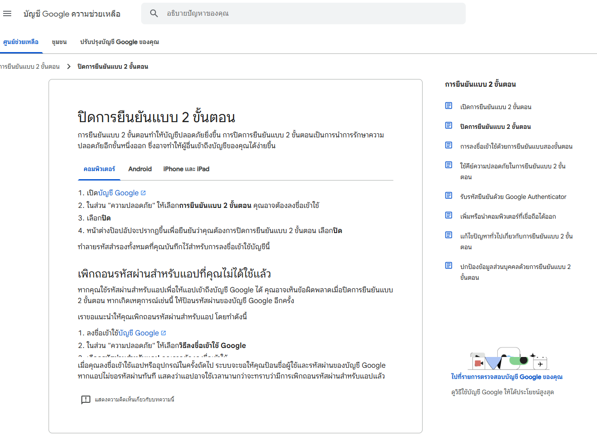
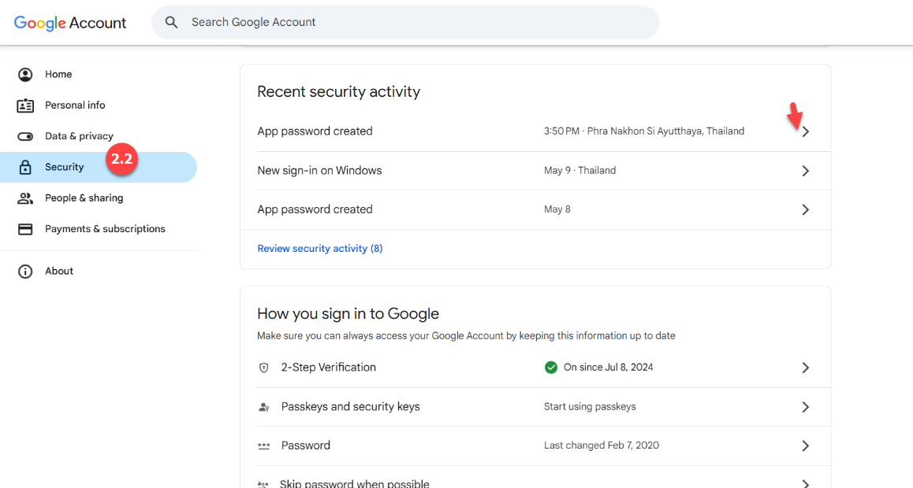
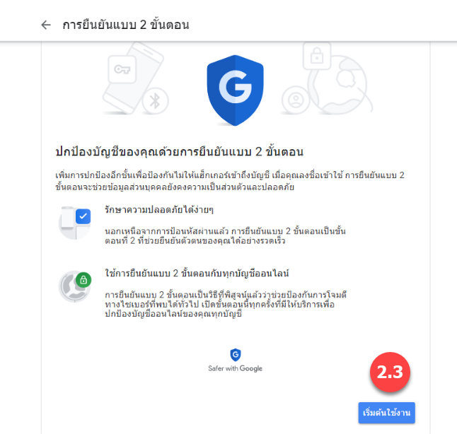
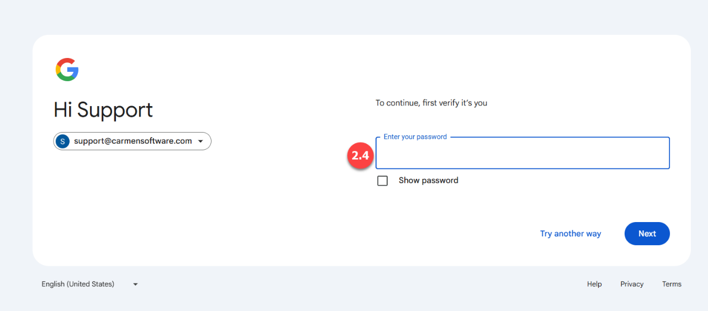
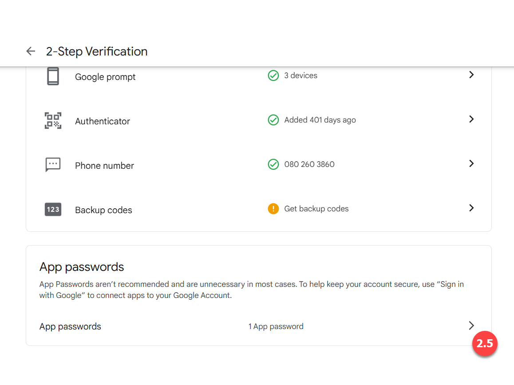
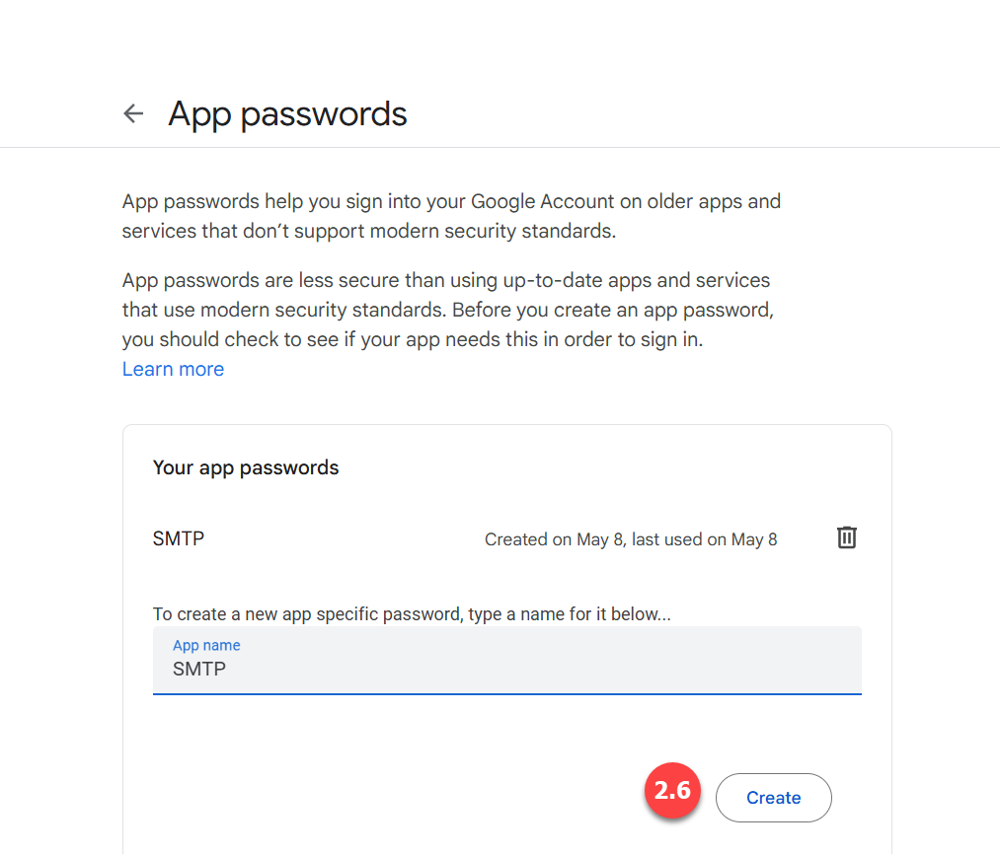
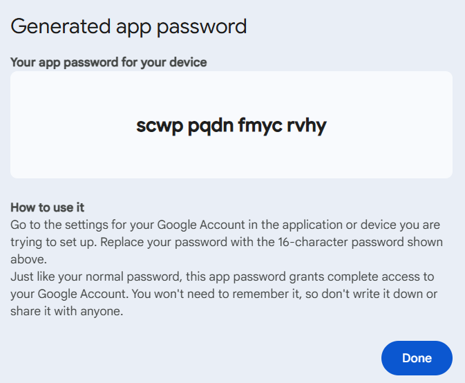
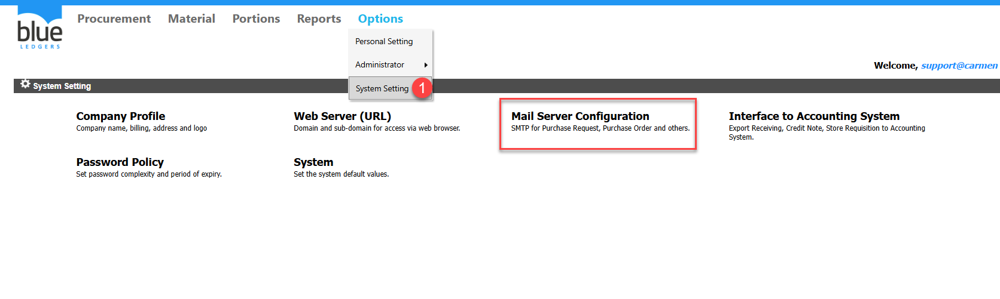
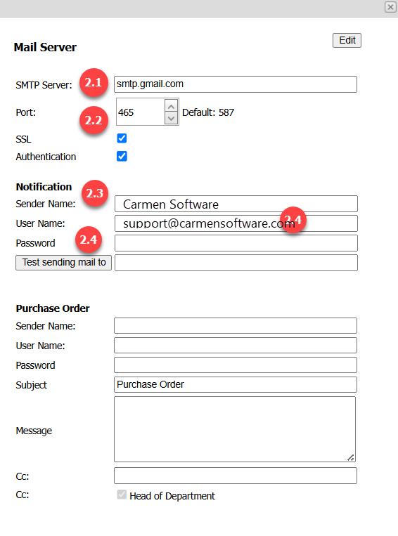
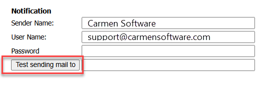

# How to set App Password Setting for Gmail

## วิธีการการตั้งค่า Email ( SMTP Gmail )

1.ล็อกอิน Gmail

2.คลิกลิงก์ เปิดการยืนยันแบบ 2 ขั้นตอน (เปิด 2 Factor Authentication)

https://support.google.com/accounts/answer/1064203?hl=th

2.1 คลิกเปิดบัญชี

2.2 คลิกความปลอดภัย เลือกการยืนยันแบบ2ขั้นตอน

2.3 คลิกเริ่มต้นการใช้งาน

2.4. ยืนยันรหัสผ่านอีเมล์

2.5 Click ลูกศร เพื่อ Create App Passwords

2.6 ตั้งชื่อ APP Name เป็น SMTP และทำการ Create

2.7 ระบบจะ Generate App Password มาให้ และให้ทำการบันทึกรหัสไว้ (เนื่องจากรหัสจะแสดงขึ้นมาเพียง 1 ครั้ง) เสร็จแล้วให้ Click Done  
  
  

## เมื่อได้รับรหัส จาก App Password 16 หลัก เรียบร้อยแล้ว มาระบุใน Mail Server  
1. Login ในระบบ Blueledger และเลือก Options > System Setting

2\. Click ปุ่ม Edit เพื่อระบุรายละเอียดของ

2.1 ระบุ SMTP Server Name เป็น smtp.gmail.com

2.2 ระบุ Port เป็น 465

2.3 ระบุ Sender Name ระบุชื่อโรงแรมหรือบริษัท

2.4 ระบุ Email Address ของโรงแรม

2.5 ระบุรหัส 16 หลัก ที่ได้จาก App Password (มีเว้นวรรคด้วย) เช่น scwp pqdn fmyc rvhy

จากนั้นใน Click ปุ่ม Save เพื่อบันทึกข้อมูล

2.6 หากต้องการทดลอง Email สามารถระบุ Email Address ปลายทางเพื่อทดสอบผลการตั้งค่า

