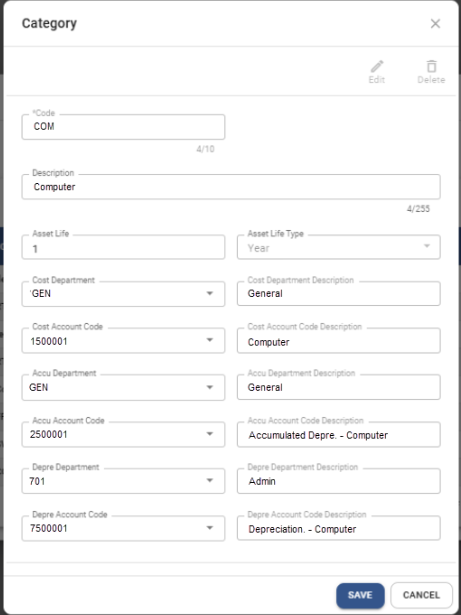
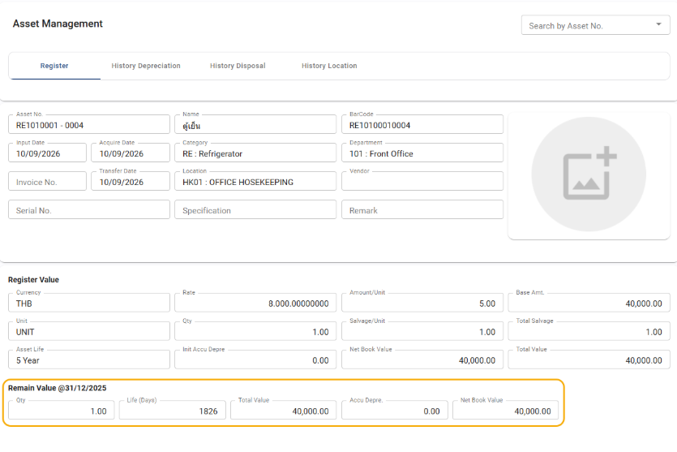
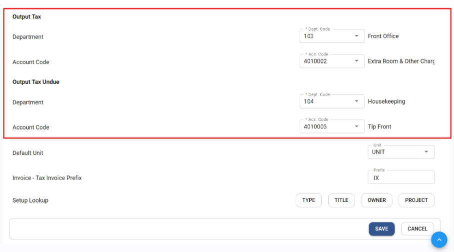

# Carmen Cloud: October 2026 Release Notes

This release includes updates to Excel JV imports, asset account settings, depreciation posting, and General Ledger reporting.

## Carmen Add-In

**Action required:** To use the Add-In updates below, update to version **3.971** and download the latest workbook.

### JV Import – Automatically Skip Zero-Amount Rows

JV Import now automatically skips rows with zero amounts (0.00), removing unnecessary lines from imported journal vouchers.

- Path: Carmen AddIn > JV Import

### JV Multiple Import – Clear Transaction Data While Preserving the Template

The Clear Data function now clears transaction data while preserving headers, formatting, and formulas, so you can reuse the template for your next import.

- Path: Carmen AddIn > JV Multiple Import

## Asset Module

### Asset Category – Default Account Codes

Administrators can now set default account codes for each Asset Category. These codes are automatically filled in when creating a new asset under that category, reducing repeated data entry.

- Path: Setting > Asset > Category

    

### Asset Register – Remaining Values Based on the Latest Closed Period

The Asset Register now displays remaining values (Net Book Value) for all asset types based on the latest closed asset period.

- Path: Asset > Asset Register

    

### Depreciation Post – Updated Account Mappings

Depreciation journal vouchers now use the updated account mappings from the Asset Register when posted. Previously posted journal vouchers remain unchanged unless they are posted again.

- Path: Asset > Monthly Process > Depreciation Post

## General Ledger Module

### Output Tax Reversal – Post Reversals from Accounts Receivable

Users can now post output tax reversals from the Accounts Receivable (AR) module through General Ledger, reducing manual journal entry work.

**Action required:** Complete the additional configuration before using this feature. Posting must be initiated by the user.

- Path: General Ledger > Procedure > Output Tax Reversal

    

### Financial Report – Corrected EBIT Calculation

The Earnings Before Interest and Taxes (EBIT) calculation formula in the standard Financial Report has been corrected to support accurate profitability reporting.

**Action required:** Please regenerate the report to reflect the corrected calculation.

- Path: General Ledger > Financial Report
